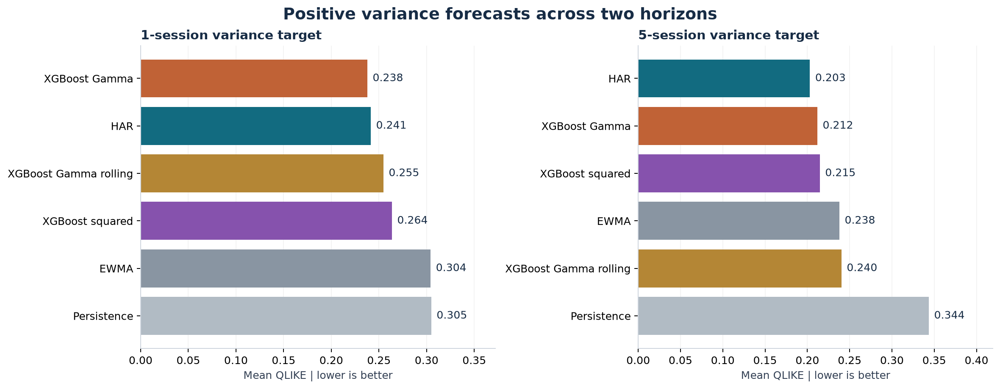

# Volatility Forecasting

I started this project to investigate whether XGBoost can improve on statistical models for forecasting volatility. The initial study uses S&P 500 realised variance and compares HAR-RV, GARCH and XGBoost with persistence and EWMA baselines.

The focus is on a fair comparison: models use information available at each forecast date, hyperparameters are selected chronologically, and uncertainty is estimated with a bootstrap that accounts for dependence over time.

Initial release — development results. Evaluation covers 2006-2017. I am keeping 2018-2019 reserved for a final evaluation after model choices are frozen. This is a forecasting study; it does not establish a profitable trading strategy.



## Initial results

- **Statistical baseline:** HAR beats the original squared-error XGBoost on average one-session QLIKE: 0.2414 versus 0.2636.
- **Invalid forecasts:** Rolling squared-error XGBoost produces six negative raw variance forecasts. Those failures remain in the results. Gamma regression with a log link produces no nonpositive forecasts in the tested expanding and rolling runs.
- **Positive-output model:** Gamma XGBoost reaches 0.2378 one-session QLIKE, but its difference from HAR has a pointwise 95% bootstrap interval spanning zero. HAR has lower average loss at the five-session horizon.
- **HAR correction:** An ML correction trained on historical out-of-sample HAR errors reaches 0.2359 one-session QLIKE; its improvement also remains unresolved by the uncertainty intervals.

| Model | One-session QLIKE | Five-session QLIKE |
| --- | ---: | ---: |
| HAR | 0.2414 | **0.2030** |
| XGBoost, squared error | 0.2636 | 0.2148 |
| XGBoost, Gamma/log link | **0.2378** | 0.2119 |
| XGBoost, Gamma/log link, rolling | 0.2547 | 0.2403 |
| EWMA | 0.3042 | 0.2379 |
| Persistence | 0.3049 | 0.3436 |

Lower is better. There are 3,019 common forecast dates at one session and 3,015 at five sessions. This table compares the direct-horizon specifications; GARCH and the HAR correction appear in the separate v2 report. Bold marks a sample minimum, not established statistical superiority. All results are exploratory development evidence.

## Research reports

| Report | Question |
| --- | --- |
| [Initial benchmark](reports/development.md) | Does squared-error XGBoost beat persistence, EWMA and HAR? |
| [Uncertainty and model extensions](reports/research_v2/research.md) | Do rolling windows, GARCH or an out-of-sample HAR correction help? |
| [Positive forecasts and multiple horizons](reports/research_v3/research.md) | Does a positive-output objective resolve invalid forecasts, and do findings persist at five sessions? |
| [Latest interpretation](docs/findings_v3.md) | What can and cannot be concluded? |
| [Experiment log](docs/experiment_log.md) | What was tried, including failures and follow-up choices? |

## Evaluation design

- **Data provenance:** pinned academic archive revision, SHA-256 verification and explicit XNYS calendar audit. Acquisition uses a public archive without an API key.
- **Temporal integrity:** civil date labels preserved across daylight-saving changes; missing sessions remain missing; incomplete windows are excluded.
- **Matured labels:** a five-session target cannot enter training until its fifth session has ended, including inner validation boundaries.
- **Fair information:** HAR and direct XGBoost use the same trailing 1/5/22-session variance features. GARCH is explicitly a different-information-set comparator.
- **Bounded selection:** four candidates per objective/horizon; two preceding chronological validation years; monthly expanding fits.
- **Uncertainty:** paired stationary bootstrap with 5/20/60-session block-length sensitivity; conditional-on-forecast-path and exploratory-selection limitations disclosed.
- **Preserved failures:** v1/v2 predictions are fingerprinted and unchanged; no failed dates are removed to improve rankings.

## Reproduce

Tested on Windows with Python 3.13. From the repository root:

```powershell
python -m venv .venv
.\.venv\Scripts\python.exe -m pip install -r requirements-lock.txt
.\.venv\Scripts\python.exe -m unittest discover -s tests -v
.\.venv\Scripts\python.exe -m volatility.experiment
.\.venv\Scripts\python.exe -m volatility.research
.\.venv\Scripts\python.exe -m volatility.horizons
```

The first experiment downloads the pinned archive if absent. Commands regenerate their own reports and local forecast/fit/tuning records. The final holdout is not evaluated by any of these commands. On macOS/Linux, substitute `.venv/bin/python`; those platforms have not yet been verified.

**Clean-environment verification, 27 October 2026:** all 32 tests passed after installation from the lock file. A fresh data download and baseline run reproduced all 12,076 model/date forecast rows byte-for-byte. This clean check reran v1 and the synthetic tests, not the full v2/v3 empirical experiments. See [verification evidence](reports/release_verification.json). GitHub-hosted CI is configured but has not yet run.

## Repository map

| Location | Contents |
| --- | --- |
| `configs/` | Recorded experiment choices, source revision and checksum |
| `volatility/` | Data acquisition, causal features, models, validation, inference and reporting |
| `tests/` | 32 temporal, statistical and end-to-end regression tests |
| `reports/` | Aggregate results, audit metadata and PNG/SVG figures |
| `docs/` | Research protocols, interpretations and source provenance |
| `data/raw/` | Local archive and manifest; Git-ignored |
| `artifacts/` | Detailed predictions, fitting lineage and tuning trials; Git-ignored |

## Limitations and planned work

This is the S&P 500 cash index, not a tradable SPY strategy. Targets measure intraday variance and exclude overnight risk. Actual historical vendor publication times are unavailable. The archive ends before the main COVID shock. A separate raw-data redistribution licence has not been established, so raw data and row-level outcomes are not bundled.

Development data has been reused across logged experiments. Bootstrap intervals do not remove model-selection bias or guarantee validity under structural change. Cross-instrument robustness, feature ablations, economic backtesting and final holdout evaluation remain future work. I plan to extend the study with additional instruments and feature ablations before freezing the final evaluation. An economic backtest will require separate assumptions about exposure, costs and execution.

See [data provenance](docs/data_decision.md) and [v1](docs/experiment_v1.md), [v2](docs/research_v2_protocol.md), [v3](docs/research_v3_protocol.md) protocols.

## References

- Heber, Lunde, Shephard and Sheppard (2009), Oxford-Man Institute's Realized Library; [pinned archive](https://github.com/jonathancornelissen/highfrequency/blob/d6eafaefee68e4bb191e1d834ae67c2dd353614c/data-raw/oxfordmanrealizedvolatilityindices.csv).
- Corsi (2009), [A Simple Approximate Long-Memory Model of Realized Volatility](https://doi.org/10.1093/jjfinec/nbp001).
- Patton (2011), [Volatility forecast comparison using imperfect volatility proxies](https://doi.org/10.1016/j.jeconom.2010.03.034).
- Boudt, Kleen and Sjoerup (2022), [Analyzing Intraday Financial Data in R: The highfrequency Package](https://doi.org/10.18637/jss.v104.i08).
- [XGBoost objective documentation](https://xgboost.readthedocs.io/en/stable/parameter.html); [time-series bootstrap documentation](https://arch.readthedocs.io/en/latest/bootstrap/timeseries-bootstraps.html).
