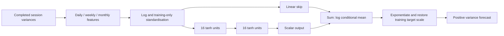

# Neural model and loss

## Forecast contract

At an origin t after realised variance is available, the model predicts the conditional mean of the next session's variance or the sum of the next five session variances. Inputs contain only daily RV and trailing five- and 22-session means. A five-session training outcome is usable only once all five sessions have ended.

The input vector is log(RV_daily), log(RV_weekly), log(RV_monthly). Each coordinate is standardised using the current training window's mean and standard deviation. These transformations do not introduce additional information. They do change the model's representation relative to the original level-feature HAR and tree models.

There are 357 trainable parameters per seed. The three-member ensemble averages forecasts in variance units. It is a fixed ensemble, not a search for the best initialisation.

## Why train on QLIKE?

For positive realised variance y and positive forecast mu, the reported loss is:

`L(y, mu) = y / mu - log(y / mu) - 1`.

Terms involving only y do not affect optimisation, so the corresponding objective is `log(mu) + y / mu`. If `mu = s * exp(z)`, where s is the training-target mean, optimisation can use:

`z + (y / s) * exp(-z)`.

This is implemented directly with automatic differentiation. Its derivative with respect to z is `1 - (y / s) * exp(-z)`. Conditional expected loss is minimised at the conditional arithmetic mean of variance, subject to the model class and optimisation. This does not require assuming the observations have a Gamma distribution.

By contrast, squared error on log(y) targets the conditional mean of log variance. Exponentiating that prediction generally does not recover the arithmetic mean of variance. This experiment avoids that retransformation issue by fitting the mean under QLIKE directly.

## Controls and interpretation

The Gamma GLM uses the same transformed inputs and a log link, with a linear predictor. It helps assess whether nonlinear layers add useful evidence beyond that representation. Differences in regularisation and numerical optimisation prevent interpreting this as a pure causal architecture experiment.

The HAR and Gamma XGBoost references retain their prior predictions. The neural and GLM configurations are fixed rather than tuned; XGBoost uses its previous nested chronological selection. A comparison of these specifications is not a claim that every model received an identical optimisation budget.

## Training and numerical behaviour

Each monthly refit starts from scratch. The network uses full-batch AdamW and a fixed epoch count, without early stopping or a validation-selected checkpoint. Seeds and deterministic CPU settings are recorded. Reproducibility across PyTorch versions and hardware is not guaranteed.

Exponentiation enforces positivity in exact arithmetic but can overflow or underflow numerically. The implementation rejects nonfinite or nonpositive forecasts and nonfinite training losses/gradients instead of silently clipping them. A linear skip allows extrapolation outside observed feature ranges, which can be useful or dangerous; positivity alone is not an accuracy guarantee.

The small number of features and relatively short single-instrument history motivate a compact network. A Transformer, LSTM or a second framework would need a separate hypothesis and evaluation design.
