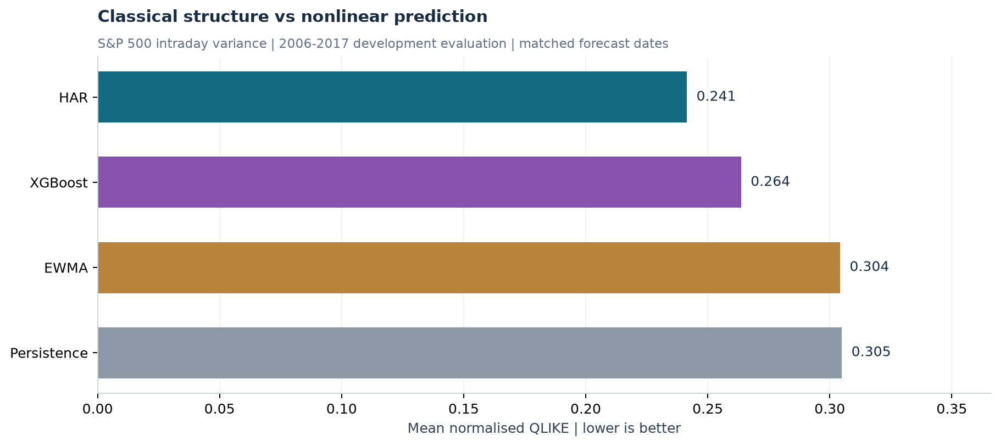
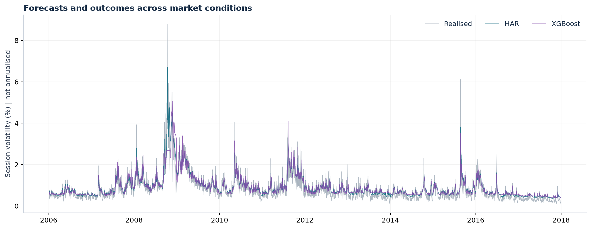
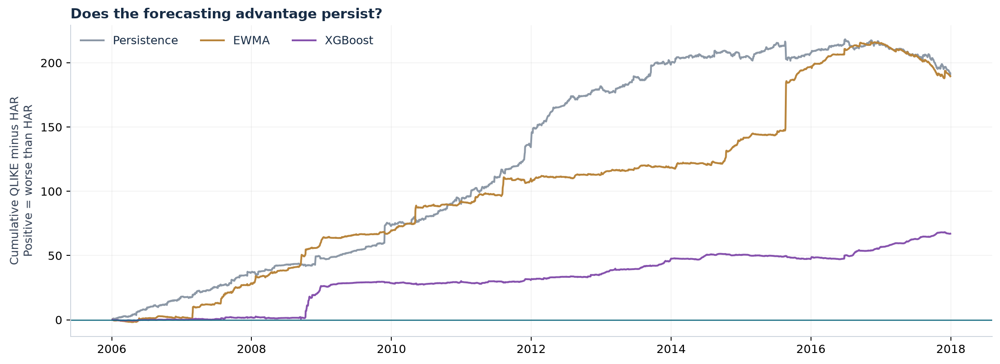
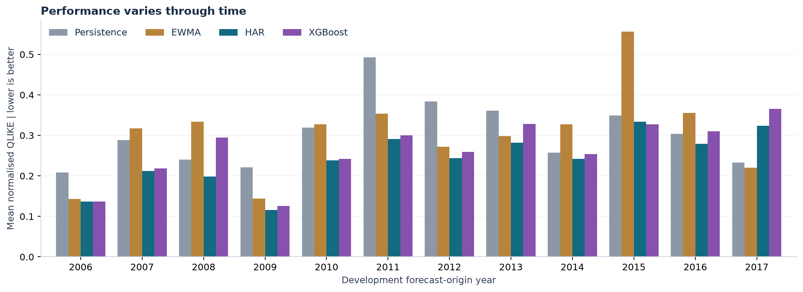

# Development benchmark: S&P 500 realised variance

**Status: development results; final 2018-2019 holdout remains unevaluated.**

HAR has the lowest average QLIKE in this prespecified first experiment. This is descriptive evidence, not a statistical-significance claim. All four models use identical eligible forecast dates; HAR and XGBoost use identical daily, weekly and monthly variance features.



| Model | Mean QLIKE | Variance MSE | QLIKE minus HAR | Forecasts |
| --- | ---: | ---: | ---: | ---: |
| HAR | 0.2414 | 4.054e-08 | +0.0000 | 3,019 |
| XGBoost | 0.2636 | 5.397e-08 | +0.0222 | 3,019 |
| EWMA | 0.3042 | 4.809e-08 | +0.0628 | 3,019 |
| Persistence | 0.3049 | 5.595e-08 | +0.0635 | 3,019 |

## Design

- Forecast origin: after session close; outcome: next-session intraday variance (rv5).
- Actual origins: 2006-01-03 to 2017-12-28.
- Actual target dates: 2006-01-04 to 2017-12-29.
- Monthly expanding fits; XGBoost selected annually from four candidates using two preceding chronological validation years.
- EWMA decay 0.94; positive forecast floor 1e-10. HAR and XGBoost fit variance levels, scaled by 10,000.
- QLIKE uses observed/forecast - log(observed/forecast) - 1. Smaller is better; signed differences are directly comparable.
- No trading returns, Sharpe ratio or executable-strategy claims.







## Data integrity and limitations

Source: Oxford-Man Realized Library archive hosted by the academic highfrequency project; pinned revision `d6eafaefee68e4bb191e1d834ae67c2dd353614c`.

There are 5,052 instrument observations across the archive and 14 missing XNYS sessions. Civil date labels are preserved; converting midnight labels to UTC would incorrectly move summer dates backwards. Missing sessions are not imputed; incomplete feature/target windows are excluded. Calendar gaps and software versions are recorded in data_audit.json.

This is an S&P 500 index experiment, not an SPY trading backtest. Intraday variance excludes overnight risk. Historical publication timestamps are unavailable, so real-time availability is assumed. The archive ends before the main COVID shock. Regime analysis, dependence-aware uncertainty, expanded tuning/objective experiments and the untouched holdout are future work. Repeated development experiments must be logged; these results are not an independent final test.

## Reproduction

From the repository root, install requirements-lock.txt, then run:

```bash
python -m unittest discover -s tests -v
python -m volatility.experiment
```

The first run retrieves the pinned archive and checks its SHA-256. Raw data, row-level predictions, fit records and tuning logs remain in Git-ignored data/ and artifacts/. Aggregate reports and figures are generated here. The source archive is publicly hosted; a separate data-specific redistribution licence has not been established, so raw data is not bundled.
