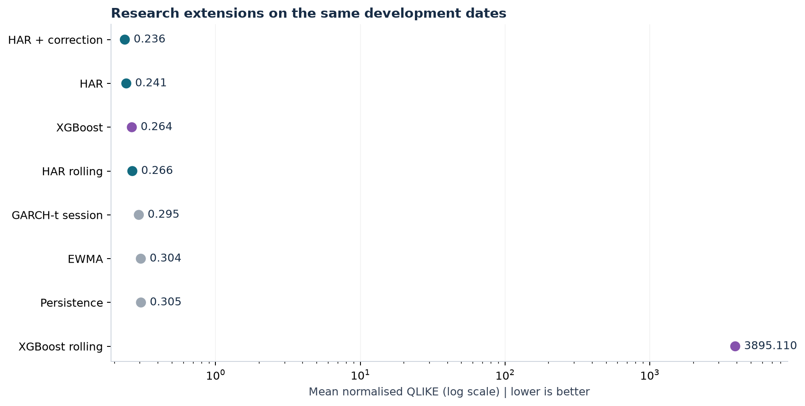
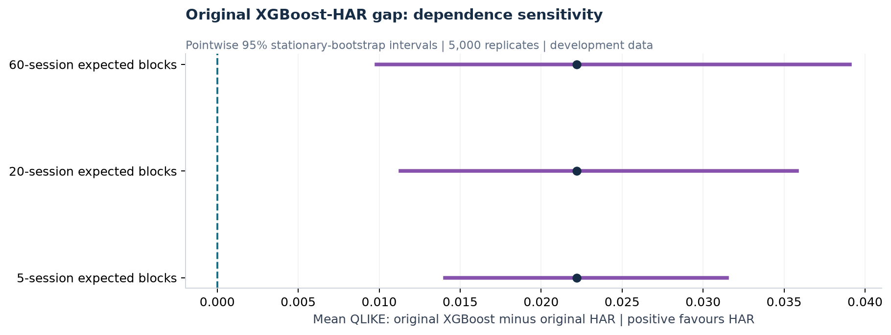
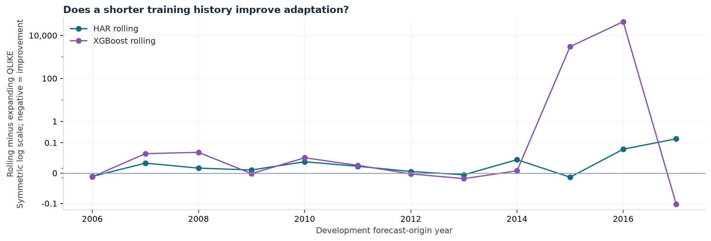

# Part 2: uncertainty, adaptation and additional benchmarks

**Exploratory development research. The 2018-2019 final holdout remains unevaluated.**

The lowest average QLIKE in this expanded comparison is achieved by **HAR + correction**. Every model predicts the same 3,019 dates. Original model forecasts are reused unchanged, with a SHA-256 fingerprint recorded in run_metadata.json.



| model | qlike | mse | observations | floor_hits |
| --- | ---: | ---: | ---: | ---: |
| HAR + correction | 0.2359 | 4.621e-08 | 3019 | 0 |
| HAR | 0.2414 | 4.054e-08 | 3019 | 0 |
| XGBoost | 0.2636 | 5.397e-08 | 3019 | 0 |
| HAR rolling | 0.2658 | 4.161e-08 | 3019 | 0 |
| GARCH-t session | 0.2947 | 4.915e-08 | 3019 | 0 |
| EWMA | 0.3042 | 4.809e-08 | 3019 | 0 |
| Persistence | 0.3049 | 5.595e-08 | 3019 | 0 |
| XGBoost rolling | 3895.1096 | 6.340e-08 | 3019 | 6 |


Read [the interpretation](../../docs/findings_v2.md) for the distinction between a small estimated hybrid gain and evidence strong enough to trust it. Rolling XGBoost produced six negative raw variance predictions, retained at the declared floor; this failure dominates its loss and makes the unstudentised family bands uninformative. No failed dates were removed.

QLIKE is dimensionless and lower is better. Variance MSE is in squared-variance units. Floor hits count forecasts clipped to the common positive floor; inspect them before interpreting a model's average loss.

## Uncertainty in paired loss differences



Primary expected block length: 20 sessions; 5,000 stationary-bootstrap replicates. All seven difference series share sampled dates. The sensitivity table also reports expected block lengths of 5 and 60 in uncertainty.csv.

| model | mean_difference | pointwise_low | pointwise_high | family_low | family_high |
| --- | ---: | ---: | ---: | ---: | ---: |
| EWMA | 0.0628 | 0.0331 | 0.0988 | -6999.0229 | 6999.1484 |
| GARCH-t session | 0.0533 | 0.0395 | 0.0677 | -6999.0324 | 6999.1389 |
| HAR + correction | -0.0056 | -0.0140 | 0.0024 | -6999.0912 | 6999.0801 |
| HAR rolling | 0.0243 | 0.0137 | 0.0364 | -6999.0613 | 6999.1100 |
| Persistence | 0.0635 | 0.0384 | 0.0892 | -6999.0221 | 6999.1491 |
| XGBoost | 0.0222 | 0.0113 | 0.0358 | -6999.0634 | 6999.1078 |
| XGBoost rolling | 3894.8682 | 0.0200 | 11433.4198 | -3104.2174 | 10893.9538 |


Positive differences favour expanding HAR. Pointwise intervals apply to individual comparisons; family bands use the bootstrap maximum absolute centred mean deviation across the seven comparisons. Family bands address this finite simultaneous comparison family, not the whole adaptive research process. They may be wide if one model has extreme loss variation.

These intervals are conditional on saved forecast paths. Models are not refitted or reselected within each bootstrap replicate. They rely on approximate stationarity and sufficient short-range dependence representation, which structural breaks can undermine. The choice to investigate these variants followed inspection of v1, so these are not independent confirmatory results. No bootstrap frequency is presented as a p-value.

## Training-window sensitivity



Rolling models use the last 756 eligible training rows. XGBoost retains the hyperparameters selected from past data in the original expanding experiment, isolating the window change rather than tuning a new rolling model. The comparison does not establish the optimal training-window length.

## Volatility regimes known at forecast time

Regimes use the current five-session RV average compared with expanding 25th/75th percentile thresholds calculated from prior weekly averages only. All models use the same regime assignments. They do not use future realised volatility to define a forecast-time regime.

| regime | EWMA | GARCH-t session | HAR | HAR + correction | HAR rolling | Persistence | XGBoost | XGBoost rolling |
| --- | ---: | ---: | ---: | ---: | ---: | ---: | ---: | ---: |
| Low | 0.2630 | 0.3007 | 0.2477 | 0.2245 | 0.2969 | 0.2964 | 0.2748 | 0.2535 |
| Middle | 0.3376 | 0.2874 | 0.2473 | 0.2482 | 0.2548 | 0.3254 | 0.2516 | 588.0310 |
| High | 0.3155 | 0.2990 | 0.2135 | 0.2315 | 0.2230 | 0.2748 | 0.2677 | 20485.0536 |


## Extrapolation diagnostic

A row is outside the original monthly training range if any of its three HAR/XGBoost features is below the historical minimum or above the maximum. This diagnostic uses information available at the fit and forecast times, not outcomes. It is descriptive and does not establish why a model wins or loses.

| outside_training_range | EWMA | GARCH-t session | HAR | HAR + correction | HAR rolling | Persistence | XGBoost | XGBoost rolling |
| --- | ---: | ---: | ---: | ---: | ---: | ---: | ---: | ---: |
| False | 0.3039 | 0.2928 | 0.2394 | 0.2352 | 0.2610 | 0.3037 | 0.2545 | 4056.3234 |
| True | 0.3128 | 0.3398 | 0.2908 | 0.2525 | 0.3808 | 0.3357 | 0.4849 | 0.4545 |


See regime_metrics.csv and range_metrics.csv for sample sizes; annual_metrics.csv retains every development year. The 2008 and 2017 periods were selected after v1 and are descriptive case studies.

## Out-of-sample HAR correction

The correction model learns actual variance minus historical HAR forecasts generated by earlier monthly fits. A residual enters training only after its target session has ended. The correction model has fixed depth 2, 100 trees and learning rate 0.03, and uses the same three variance features. Minimum matured residual count in this run: 685.

The correction is additive in variance levels, with the common positivity floor. It can overcorrect in low-volatility periods; a failed correction is retained rather than retrospectively replaced with a better-looking specification.

## GARCH target and fitting assumptions

GARCH(1,1) uses Student-t innovations and zero conditional mean on open-to-close log returns, scaled to percent. Its next-session return-variance forecast is evaluated against intraday realised variance, a noisy proxy under the stated modelling assumptions. It uses returns rather than the matched variance features, so it is an additional session-risk comparator.

Missing return sessions are not compressed. Each fit starts after the latest missing return and uses a contiguous history. Parameters are refitted monthly, with variance state updated after each observed session. Non-converged fits: 0. Maximum fitted alpha + beta: 1.000000. Boundary persistence near one warrants caution about long-run variance interpretations.

## Reproduce and inspect

```bash
python -m unittest discover -s tests -v
python -m volatility.research
```

Run the original experiment first if artifacts/development is absent. New detailed forecasts, historical out-of-sample HAR residual sources and fit lineage are in artifacts/research_v2 (Git-ignored). This report and aggregate diagnostics are separate from v1.

Methods: [stationary bootstrap documentation](https://arch.readthedocs.io/en/latest/bootstrap/timeseries-bootstraps.html), [GARCH forecast recursion](https://arch.readthedocs.io/en/latest/univariate/forecasting.html).

Multi-instrument robustness, five-day targets and feature-group ablations remain Part 2 work. Economic backtesting and final holdout evaluation remain Part 3 work.
