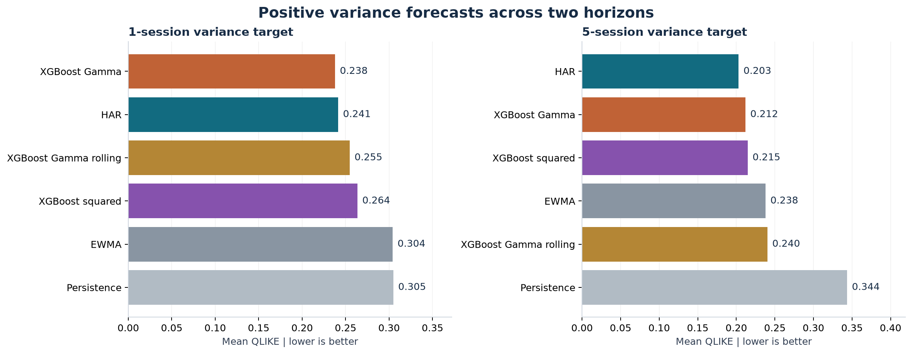
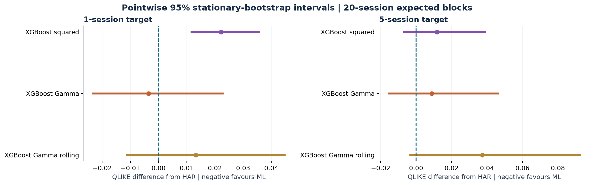

# Positive-output modelling and five-session forecasts

**Exploratory development results, 2006-2017. The final holdout remains unevaluated.**

Gamma regression with a log link predicts a positive conditional mean. Its fixed-shape mean-dependent loss is proportional to log(mu) + y/mu, aligning with QLIKE. This is a quasi-likelihood choice, not an assertion that variance follows an exact Gamma distribution. Unlike fitting log targets with squared error, it does not need a lognormal mean retransformation.



## 1-session target

| model | qlike | mse | observations |
| --- | ---: | ---: | ---: |
| XGBoost Gamma | 0.2378 | 5.425e-08 | 3019 |
| HAR | 0.2414 | 4.054e-08 | 3019 |
| XGBoost Gamma rolling | 0.2547 | 5.477e-08 | 3019 |
| XGBoost squared | 0.2636 | 5.397e-08 | 3019 |
| EWMA | 0.3042 | 4.809e-08 | 3019 |
| Persistence | 0.3049 | 5.595e-08 | 3019 |


## 5-session target

| model | qlike | mse | observations |
| --- | ---: | ---: | ---: |
| HAR | 0.2030 | 5.931e-07 | 3015 |
| XGBoost Gamma | 0.2119 | 8.867e-07 | 3015 |
| XGBoost squared | 0.2148 | 1.362e-06 | 3015 |
| EWMA | 0.2379 | 6.929e-07 | 3015 |
| XGBoost Gamma rolling | 0.2403 | 9.528e-07 | 3015 |
| Persistence | 0.3436 | 1.079e-06 | 3015 |


The five-session target is the sum of the next five intraday realised variances. It is not the variance of the cumulative five-session return. Models use identical dates within a horizon; horizons have different eligible sample counts. The variance MSE values have different target scales, so comparisons across horizons should not be treated as a ranking of forecast difficulty.

## Dependence-aware uncertainty



| Model | mean_difference | pointwise_low | pointwise_high | family_low | family_high |
| --- | ---: | ---: | ---: | ---: | ---: |
| (1, 'EWMA') | 0.0628 | 0.0337 | 0.0974 | 0.0277 | 0.0978 |
| (1, 'Persistence') | 0.0635 | 0.0386 | 0.0888 | 0.0285 | 0.0985 |
| (1, 'XGBoost Gamma') | -0.0036 | -0.0232 | 0.0228 | -0.0386 | 0.0314 |
| (1, 'XGBoost Gamma rolling') | 0.0133 | -0.0112 | 0.0447 | -0.0218 | 0.0483 |
| (1, 'XGBoost squared') | 0.0222 | 0.0117 | 0.0357 | -0.0128 | 0.0572 |
| (5, 'EWMA') | 0.0349 | 0.0016 | 0.0708 | -0.0177 | 0.0875 |
| (5, 'Persistence') | 0.1406 | 0.1008 | 0.1878 | 0.0881 | 0.1932 |
| (5, 'XGBoost Gamma') | 0.0088 | -0.0155 | 0.0463 | -0.0437 | 0.0614 |
| (5, 'XGBoost Gamma rolling') | 0.0373 | -0.0033 | 0.0926 | -0.0152 | 0.0899 |
| (5, 'XGBoost squared') | 0.0118 | -0.0068 | 0.0389 | -0.0408 | 0.0643 |


Differences are model minus HAR. Negative values favour the listed model. These are 5,000-replicate stationary-bootstrap intervals, with 20-session expected blocks primary and 5/60-session sensitivity in uncertainty.csv. Five-session outcomes overlap; the block procedure accounts for local dependence approximately, not through an assumption that observations are independent.

Pointwise intervals concern individual comparisons. Family bands cover the specified five-comparison family within each horizon approximately; they are not adjusted for both horizons, all earlier experiments or adaptive research choices. Models are not refitted or retuned inside the bootstrap. Structural breaks can violate the approximate-stationarity assumption.

## Positivity audit

| Model | raw_nonpositive | floor_hits |
| --- | ---: | ---: |
| (1, 'EWMA') | 0 | 0 |
| (1, 'HAR') | 0 | 0 |
| (1, 'Persistence') | 0 | 0 |
| (1, 'XGBoost Gamma') | 0 | 0 |
| (1, 'XGBoost Gamma rolling') | 0 | 0 |
| (1, 'XGBoost squared') | 0 | 0 |
| (5, 'EWMA') | 0 | 0 |
| (5, 'HAR') | 0 | 0 |
| (5, 'Persistence') | 0 | 0 |
| (5, 'XGBoost Gamma') | 0 | 0 |
| (5, 'XGBoost Gamma rolling') | 0 | 0 |
| (5, 'XGBoost squared') | 0 | 0 |


Gamma forecasts are checked before any clipping; a nonpositive or nonfinite output stops the run. Squared-error models retain the original declared numerical floor. The failed rolling squared-error specification remains in v2, including all six failures. Gamma changes objective, link and selected hyperparameters, so a performance difference cannot be attributed solely to positivity.

## Temporal design

- Same trailing 1/5/22-session variance features for HAR and XGBoost.
- Direct HAR and XGBoost models for each horizon; persistence and EWMA multiplied by the horizon.
- Separate nested chronological selection by objective and horizon, with the original four-candidate budget.
- Monthly expanding fits; rolling Gamma uses the last 756 eligible rows and the expanding Gamma selection.
- Every training label must have matured at the fit date, including all five sessions of a multi-session target.
- Missing sessions invalidate full feature/target windows; no partial target sums or filling.
- Validation outcomes must mature before the outer year; all development targets end before 2018.

## Reproduce

```bash
python -m unittest discover -s tests -v
python -m volatility.horizons
```

Raw predictions, trial records and fit lineage are in artifacts/research_v3 (Git-ignored). Aggregate outputs are separate from earlier runs. If v1 predictions exist, the one-session reference forecasts are checked for agreement at rtol=1e-6, atol=1e-12. Existing v1/v2 file fingerprints are verified unchanged.

The next independent checks are additional instruments and eventually the reserved final period. This release does not claim tradable profits or a general ML advantage.

Source for the objective: [XGBoost parameter documentation](https://xgboost.readthedocs.io/en/stable/parameter.html).
