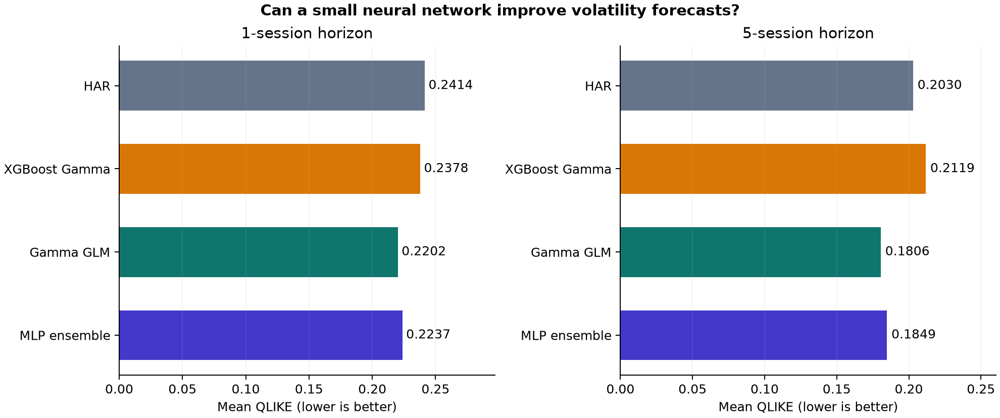
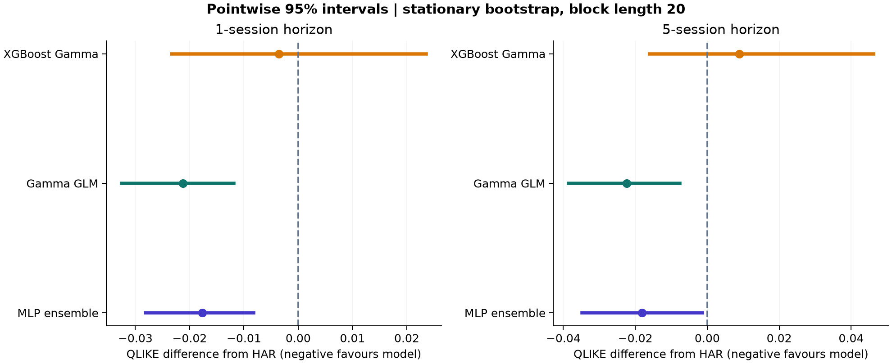
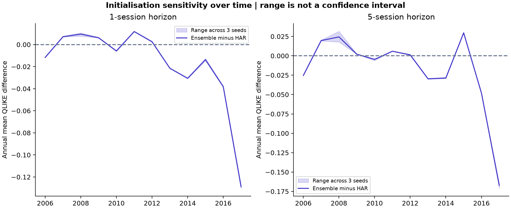

# Neural volatility forecasting: development experiment v4

A fixed small PyTorch network trained on QLIKE is compared with a positive Gamma GLM, HAR and the existing Gamma XGBoost. No architecture or seed was selected using these results.

## Results

| Horizon | Model | QLIKE | Variance MSE | Forecasts |
| --- | --- | ---: | ---: | ---: |
| 1 | Gamma GLM | 0.220174 | 3.819e-08 | 3019 |
| 1 | MLP seed 101 | 0.223563 | 4.22257e-08 | 3019 |
| 1 | MLP seed 17 | 0.223722 | 4.27918e-08 | 3019 |
| 1 | MLP ensemble | 0.223741 | 4.25515e-08 | 3019 |
| 1 | MLP seed 43 | 0.224027 | 4.26695e-08 | 3019 |
| 1 | XGBoost Gamma | 0.237846 | 5.42486e-08 | 3019 |
| 1 | HAR | 0.241438 | 4.05402e-08 | 3019 |
| 5 | Gamma GLM | 0.180610 | 5.45458e-07 | 3015 |
| 5 | MLP seed 101 | 0.184350 | 7.03011e-07 | 3015 |
| 5 | MLP seed 17 | 0.184621 | 7.14795e-07 | 3015 |
| 5 | MLP ensemble | 0.184920 | 7.16988e-07 | 3015 |
| 5 | MLP seed 43 | 0.186009 | 7.34279e-07 | 3015 |
| 5 | HAR | 0.203017 | 5.93128e-07 | 3015 |
| 5 | XGBoost Gamma | 0.211856 | 8.86669e-07 | 3015 |

## Paired uncertainty

Negative differences favour the model. These are pointwise intervals, conditional on saved forecast paths. Simultaneous family bands and block-length sensitivity are in uncertainty.csv. The GLM contrast is a separate exploratory comparison.

| Horizon | Model | Reference | Difference | 95% interval, block 20 |
| --- | --- | --- | ---: | --- |
| 1 | Gamma GLM | HAR | -0.021264 | [-0.032537, -0.011881] |
| 1 | MLP ensemble | HAR | -0.017697 | [-0.028153, -0.008207] |
| 1 | XGBoost Gamma | HAR | -0.003592 | [-0.023271, +0.023593] |
| 1 | MLP ensemble | Gamma GLM | +0.003567 | [+0.000444, +0.007702] |
| 5 | Gamma GLM | HAR | -0.022407 | [-0.038520, -0.007582] |
| 5 | MLP ensemble | HAR | -0.018098 | [-0.034766, -0.001406] |
| 5 | XGBoost Gamma | HAR | +0.008838 | [-0.015966, +0.046162] |
| 5 | MLP ensemble | Gamma GLM | +0.004309 | [-0.002847, +0.014634] |

## Seed sensitivity

All three fixed seeds are reported. The ensemble averages variance predictions, not log predictions. Seed dispersion is optimisation sensitivity, not calibrated forecast uncertainty.

## Design and limits

The network has two 16-unit tanh layers and a linear skip connection (357 parameters per seed). Training uses 200 full-batch AdamW epochs per monthly refit. Feature standardisation and target scaling use matured training rows only. Outputs are positive conditional means trained with QLIKE, not exponentiated squared-error predictions of log variance.

The GLM shares the neural feature representation and positive link, but has different regularisation and optimisation. HAR and Gamma XGBoost are unchanged v3 references. Equal underlying inputs do not imply identical training or tuning budgets: the neural/GLM specifications are fixed; XGBoost was selected chronologically.

The study remains one instrument, 2006-2017 development data reused across experiments. No final holdout, trading profitability, COVID robustness or general neural superiority is established. Bootstrap intervals do not include refitting or all research-selection uncertainty. CPU determinism is environment-specific.

Total experiment runtime: 588.0 seconds. Previous benchmark outputs unchanged: True. Final holdout evaluated: False.

See [protocol](../../docs/research_v4_protocol.md), [compute costs](compute.csv), [annual results](annual_metrics.csv), [regime results](regime_metrics.csv), and [uncertainty](uncertainty.csv).
